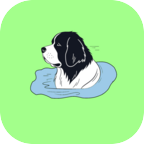
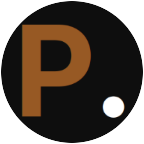

## Hi, I'm Kaj Suaning 👋

Welcome to my GitHub. Not much here is public, but hopefully you find something useful. Issues and pull requests are always welcome!

### 🛠️ What I'm working on

My software consulting business and my line of IoT devices.

---

### My businesses

#### [Pontec Automation](https://app.pontec.au/product)
IoT devices, starting with a smart gate controller and moving into agtech.

 

---

#### [Podfilter](https://apps.apple.com/au/app/podfilter-podcast-player/id6822980830)
A podcast player for finding shows and listening at your own pace. iOS for now, Android coming later.

 

---

#### [Buyers AIgent](https://buyersaigent.com.au)
AI that collects and analyses data on the Australian property market.

 

---

#### [Pontec Consulting](https://pontec.au)
Software consulting, and the company my IoT devices are developed under.

 
